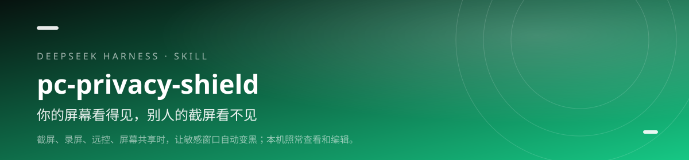

<div align="center">



<h1>pc-privacy-shield · 一键 PC 隐私防护</h1>

<p><b>你的屏幕看得见，别人的截屏看不见。</b></p>

<p>截屏、录屏、远控、屏幕共享时，让敏感窗口自动变黑；本机照常查看和编辑。</p>

[](https://github.com/lilinshuei/pc-privacy-shield/actions/workflows/validate.yml)
[](LICENSE)
[](https://www.npmjs.com/package/pc-privacy-shield)
[](https://github.com/topics/dsh-plugin)
[](#环境要求)

</div>

---

## 它解决什么问题

“防窥屏”其实混着两种完全不同的威胁：怕被看到，和怕被拿走。前者是画面合成问题，后者是文件加密问题，用错手段等于没防。

这个 Skill 把两条线分开：WDA_EXCLUDEFROMCAPTURE 让窗口在别人的截屏、录屏、远控画面里变黑；AES-256-GCM 把静态文件变成密文。它还会在启动时实测跨进程可行性，失败就降级到自建查看器，并明确告诉你哪些情况防不住。

## 你会得到什么

- **防看到：WDA 窗口保护** — 第三方窗口能直接保护；不行就自动启用自建查看器，本机显示正常，捕获画面为黑。
- **防拿走：AES-256-GCM** — 本地加密静态文件，写盘前强制明文零泄漏断言；口令只在你手里。
- **不锁死自己** — 查看器默认“可修改”，能正常输入；Ctrl+S 显式保存，自动备份，保留原编码与换行。
- **诚实的能力边界** — 不防文件被复制、不防注入式截屏与驱动级捕获；WDA 不是加密，不能替代加密。
- **零依赖离线** — 不联网、不改注册表、不改文件关联、不删除任何文件；主路径不需要 Node / Python。

## 安装

### npm 一行安装（推荐）

```powershell
dsh plugin --profile web add pc-privacy-shield
```

包已发布到 npm registry，命令最短，也不依赖 GitHub 访问。桌面端把 `web` 换成 `desktop`；装完重启 DSH，新会话即可调用。

### 从 GitHub 安装

```powershell
dsh plugin --profile web add github:lilinshuei/pc-privacy-shield
```

想跟最新提交，或 npm 拉取不畅时用这条。

### 手动安装

```bash
git clone https://github.com/lilinshuei/pc-privacy-shield.git
mkdir -p ~/.dsh/skills
cp -r pc-privacy-shield ~/.dsh/skills/
```

最终路径是 `~/.dsh/skills/pc-privacy-shield/SKILL.md`。仓库根目录就是 Skill 本体，不用再找子目录。

## 快速上手

### 1. 放到目标目录

```powershell
Copy-Item scripts\launch.cmd "<目标目录>\"
```

双击启动器即可；它默认在该目录找 *.txt，优先匹配标题含“密码本”的文件。

### 2. 装在别处时指定技能目录

```powershell
$env:PC_SHIELD_HOME = "$HOME\.dsh\skills\pc-privacy-shield"
```

默认就从这个位置加载 pc-shield.ps1，装在默认路径时不用设置。

### 3. 核验报告

```powershell
notepad "$env:APPDATA\PCPrivacyShield\report.json"
```

看 mode 与 wdaSelfRead；0x11 表示窗口保护生效。报告不含明文。

## 能力边界

- WDA 只影响“给别人看的画面合成”，不阻止文件被复制、上传或打包带走。
- 不防注入式截屏、虚拟机外录、采集卡与驱动级捕获；任何软件都很难覆盖这些路径。
- 无 root / 管理员权限时，部分第三方窗口可能无法直接保护，会自动降级为自建查看器。
- 请只保护自己拥有或已获授权查看的文件与窗口。

## 环境要求

| 项 | 要求 |
|---|---|
| 操作系统 | Windows 10 / 11 |
| 运行时 | PowerShell 5.1（系统自带） |
| 主路径依赖 | 不需要 Node / Python |
| 加密功能 | 需要 Node.js（随技能脚本提供） |

## 仓库里有什么

```
pc-privacy-shield/
├── scripts/pc-shield.ps1
├── scripts/launch.cmd
├── scripts/file-vault.cjs / protect-file.cjs
├── scripts/inject.cjs / shield.web.js / shield.css
├── scripts/desktop-guard.cjs
├── scripts/verify.cjs
├── references/
├── lib/index.js          # DSH 插件适配层（零依赖）
├── cordis.patch.yml      # DSH 挂载声明
├── tools/                # 仓库自检 + 适配层冒烟测试
└── README.md
```

- scripts/pc-shield.ps1 — 主程序：探测、保护、降级查看器
- scripts/launch.cmd — 纯 ASCII 启动器，避免中文路径问题
- scripts/file-vault.cjs / protect-file.cjs — 本地文件加密
- scripts/inject.cjs / shield.web.js / shield.css — 给 HTML 工作台加防护
- scripts/desktop-guard.cjs — Electron 窗口内容保护
- scripts/verify.cjs — 仓库自检
- references/ — 能力边界、实现细节、命令参考

## 安全与隐私

- **零遥测**：不上报使用数据、不内置统计、不访问外部接口。
- **本地执行**：所有处理都在你的机器上完成；需要联网时只发生在你自己执行的包管理器或下载命令里。
- **不删文件**：仓库脚本以“只新增、不删除”为约束；需要清理时会先说明并留回退路径。
- **无凭据**：仓库不包含账号、令牌、Cookie 或本机绝对路径。发现问题请按 [SECURITY.md](SECURITY.md) 私下报告。

## 同系列 Skill

| Skill | 一句话 |
|---|---|
| **[novel-atlas](https://github.com/lilinshuei/novel-atlas)** | 把一本小说，变成一座可以走进去的世界。 |
| **[blank-workbench](https://github.com/lilinshuei/blank-workbench)** | 一句话，得到一个能直接干活的工作台。 |
| **[task-complete-chime](https://github.com/lilinshuei/task-complete-chime)** | 任务跑完了，别再盯着屏幕等。 |
| **[phone-media-transfer-android-app](https://github.com/lilinshuei/phone-media-transfer-android-app)** | App 说找不到文件夹？那就从电脑直接送进去。 |
| **[source-to-app](https://github.com/lilinshuei/source-to-app)** | 源码到双击即用，只差这一条命令。 |

## License

MIT © 2026 lilinshuei。本 Skill 为原创设计；第三方依赖与素材在各自目录内单独标注。

---

如果它替你省下了时间，点一个 **Star**，让更多人找到它。
